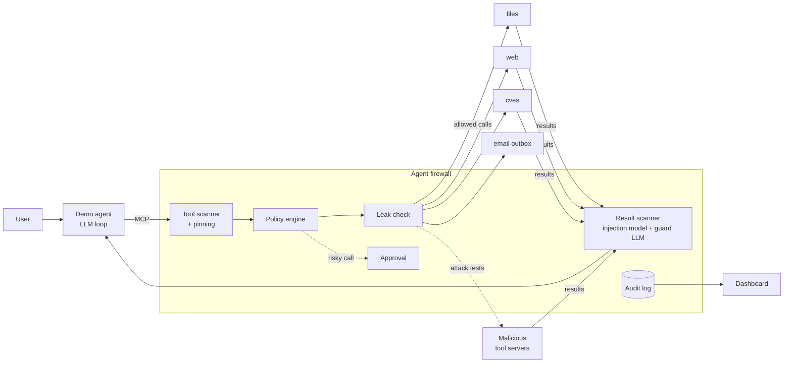
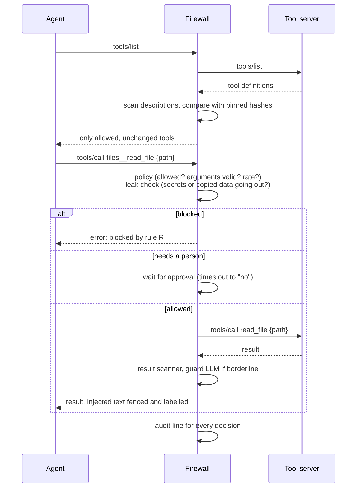

# Architecture (v1)

Written before any code. It will change as the build teaches me things, and each change gets a line under "Decisions".

## Context

An AI agent with real tools, plus the security layer that stops it being turned against its user.

**The agent:** a security assistant that answers questions like "what happened on this server last night?". It reads log files, searches the web, looks up CVEs and can draft an email report. It uses MCP (Model Context Protocol) tool servers, the way agents connect to tools now.

**The firewall:** it sits between the agent and every tool server. It checks tool descriptions before the agent sees them, and every tool call before it runs. It also checks what each tool returns before it goes back to the model, and it logs every decision.

**The questions it answers, with numbers:**
1. **How often do known agent attacks get through, with the firewall on and off?** The attacks are poisoned tool descriptions, instructions hidden in web pages and logs, data leaking out through tool arguments, and a tool changing after it was approved.
2. **How often does it get in the way of normal work?** That's false blocks on ordinary agent tasks.
3. **What does it cost in latency?**

**Why this project:**
- Agents with MCP tools are what AI engineer roles ask for now.
- Securing them is new: OWASP's Top 10 for LLM applications and its agentic AI threat list both name these attacks.
- It builds on my [prompt-injection-guard](https://github.com/AnoushahWasif/prompt-injection-guard) project, whose model becomes one of the firewall's checks.

**Two LLMs of our own:**
- **A guard model:** a small open LLM, fine-tuned with LoRA to judge tool calls and tool results, used as one of the firewall's checks.
- **A tiny GPT trained from scratch:** a learning notebook that shows how an LLM works inside, from the tokenizer to attention and training.

## Components

| Component | What it does |
|---|---|
| **Demo agent** | A small agent loop: the LLM picks a tool, the call goes out through the firewall, the result comes back. One adapter for a local open model through Ollama (free, on this laptop); tests use a scripted fake model |
| **Tool servers (MCP)** | Our own small servers: `files` (read-only, one folder), `web` (fetch a page), `cves` (OSV lookup), `email` (writes to an outbox folder, never really sends). Plus deliberately malicious servers for the attack tests |
| **Firewall proxy** | Speaks MCP on both sides, so any MCP agent can use it, not just ours |
| ↳ Tool scanner | On `tools/list`: flags hidden instructions in descriptions (imperatives to the model, invisible Unicode, mentions of other tools or of secrets) and pins each tool's definition by hash. A changed definition is blocked until it's approved again |
| ↳ Policy engine | A TOML policy, deny by default. It sets which servers and tools are allowed, checks arguments against schemas, and keeps allow-lists for paths and URL domains, plus rate limits per tool |
| ↳ Leak check | Outgoing arguments are checked for secrets (keys, tokens, private keys), for personal data, and for content copied from earlier tool results that's heading to a tool that sends data out (web, email) |
| ↳ Result scanner | Tool results are scored by the prompt-injection-guard model. Suspicious text is fenced and labelled as untrusted data, or the result is withheld (policy decides) |
| ↳ Guard LLM | Our fine-tuned small model (see below). It judges what the rules can't settle, such as "is this tool result trying to give the agent orders?". Only borderline cases go to it, so it doesn't slow every call |
| ↳ Approval | Calls the policy marks as risky wait for a person to say yes or no |
| ↳ Audit log | One JSON line per decision: what was asked, the rule that decided, and the outcome. It holds hashes and rule ids rather than secrets |
| **Dashboard** | Next.js static site: recent decisions, blocked attacks, waiting approvals |
| **Evaluation harness** | Replays the attack set and the normal-task set with the firewall on and off, and writes the numbers to `reports/` |

## Data flow



A call goes: agent → scanner (is this tool known and unchanged?) → policy (allowed, with these arguments?) → leak check (is anything sensitive leaving?) → tool → result scanner → agent. Each step can allow, block or ask a person, and each decision is logged.

### How the proxy works

- **The agent's side:** the agent is configured with one MCP server, the firewall. The agent never learns the real servers' addresses or commands.
- **The tools' side:** the firewall starts each configured tool server itself (stdio), or connects to it (Streamable HTTP, day 16). It lists their tools under names that include the server, such as `files__read_file`, so two servers can't pass off one tool as the other.
- **What's checked:** the firewall handles `tools/list` and `tools/call` and checks both. It doesn't pass on `resources` or `prompts` in v1; the agent sees them as unavailable (decision 13).
- **Requests from a tool server to the agent are refused by default:**
  - **What they are:** MCP lets a server ask its client things. It can borrow the agent's model (`sampling`), ask the user a question (`elicitation`), or ask which folders it may use (`roots`).
  - **Why refuse them:** a malicious server can use them to talk to the model or the user directly, around every check on tool calls.

### One call, step by step



### How checks combine

- **What each check returns:** `allow`, `label` (allow, but fence part of the result), `ask` (a person decides) or `block`, with a rule id and a short reason.
- **How they combine:** the strictest answer wins, and the order is block, ask, label, allow.
- **When a check breaks:** a check that crashes or times out answers `block` for calls, and `label` for results. A broken check never lets something through silently.

### Tool scanner rules (day 4)

The scanner reads every text in a definition that reaches the model: the name and description, plus every description, title, default, example, enum value and property name inside the input schema.

| Rule | Looks for | Verdict |
|---|---|---|
| TS01 | Invisible or control characters (Unicode tags, zero-width, bidi overrides, escapes, private use) | block |
| TS02 | Orders aimed at the model: "ignore previous instructions", "don't tell the user", fake `<IMPORTANT>` or `<system>` tags, "before using this tool…", "you must also send…". Checked after NFKC folding, so full-width letters don't hide them | block |
| TS03 | Mentions of keys and credentials: `~/.ssh`, `id_rsa`, `.aws`, `.env`, `mcp.json`, API keys, tokens, passwords | ask |
| TS04 | The description names another server's tool, which is how shadowing works. Only distinctive names count (with `_`, or 8+ characters) | ask |
| TS05 | A description over 4,000 characters | ask |
| PIN01 | The definition changed since it was first seen and pinned (rug pull) | block |

### Policy rules (day 5)

The policy is a TOML file the config must name. Tools are named exactly (`files__read_file`) or by server (`cves__*`), and an exact entry beats the server's. A tool the policy doesn't name is hidden from the agent's listing and refused if called anyway. Writing a rule for one of a tool's arguments names the tool too, because TOML creates the parent table.

| Rule | Checks | Verdict |
|---|---|---|
| POL01 | The policy names the tool | block |
| POL02 | Arguments fit the tool's own input schema (JSON Schema 2020-12) and are under 64 KB. A schema that can't be used blocks, and the reason names the field, never the value | block |
| POL03 | Per-argument rules: `pattern` (whole value), `domains` (URL host or email domain, subdomains included, so `nvd.nist.gov.evil.example` doesn't count), `max_length` (for a list, the number of items), `one_of`. Lists are checked item by item | block |
| POL04 | Calls per tool within a sliding window. Only calls that go ahead count | block |
| POL05 | `ask = true`: a person approves every call, after every other check has passed | ask |

## Repository layout (planned)

```
src/agent_firewall/
    proxy/        MCP proxy: client side, server side, routing
    checks/       tool scanner, policy, leak check, result scanner, guard LLM
    policy.py     TOML loading, schema and the checks
    audit.py      hash-chained JSON lines
    agent/        demo agent loop, model adapters (scripted fake, Ollama)
    tools/        our MCP tool servers (files, web, cves, email outbox)
attacks/          attack and normal-task cases, as data, with sources
evaluation/       harness and metrics
models/           guard LLM training notebook and manifest (weights not committed)
notebooks/gpt-from-scratch/
dashboard/        Next.js static site
infra/            optional Terraform
```

## Evaluation

| Set | What's in it | Source |
|---|---|---|
| **Attacks** | About 60 cases in 6 families: poisoned tool description, tool changed after approval ("rug pull"), a tool imitating another server's tool, instructions hidden in a web page, instructions hidden in a log file, and secrets sent out through arguments | Written by us from published write-ups, each with its source noted. Some also come from public agent-attack benchmarks, if their licences allow (checked on day 2) |
| **Normal tasks** | About 60 ordinary jobs: summarise a log, look up a CVE, draft a report email | Written by us |

**Metrics:**
- Attacks stopped, per family, with the firewall on and off.
- Normal tasks wrongly blocked.
- Latency added, p50 and p95.

Agents are random, so each case runs several times, with intervals.

**Honesty rules:**
- The attack set is split. Rules are written against half of it, and the other half is scored once at the end, like a test set.
- Attacks we don't stop are kept and reported. They aren't quietly removed.

## The guard LLM (fine-tuned)

| Item | Choice |
|---|---|
| Base model | A small open instruct model, about 0.5 to 1.5B parameters, under Apache-2.0 or MIT (for example Qwen's small models). The exact model, revision and licence are pinned on its day |
| Task | Input: a tool's description, a tool call, or a tool result, with its context. Output: `safe` / `attack`, the attack type, and a one-line reason, as fixed JSON |
| Training data | The development half of our attack and normal sets, prompt-injection-guard's training data (licences already checked there), and generated variations of our own cases. The held-out attack half is never used for training |
| Method | LoRA adapters with Hugging Face PEFT, trained on a free Colab GPU. Every setting, the data hash and the base model revision are saved with the adapter |
| Running it | Adapters merged and saved as safetensors (never pickle), hash-pinned like prompt-injection-guard's model, running on the laptop CPU |
| Compared against | The rules alone, the prompt-injection-guard TF-IDF model, the base model with no fine-tuning (prompt only), and the fine-tuned model, all on the same held-out half: attacks caught, false alarms, latency |
| Honest outcome | If fine-tuning doesn't beat the cheaper checks, the README says so, and the firewall uses what works best |

## The tiny GPT (from scratch, learning notebook)

- **What gets built:** a decoder-only transformer written in PyTorch, step by step:
  - a tokenizer (byte-pair encoding, trained ourselves);
  - embeddings and self-attention with a causal mask;
  - the training loop.
- **Size and data:**
  - **Model:** about 5 to 10 million parameters, trained on a laptop CPU, or a free Colab GPU if that's too slow.
  - **Corpus:** public security text (CVE descriptions, and MITRE ATT&CK technique descriptions under its terms, with attribution).
- **What it shows:** loss curves, text samples at several points in training, and what attention looks at. It also shows clearly why this tiny model can't do the guard's job, and why fine-tuning a pretrained model is the right tool for that.
- **Where it lives:** its own folder (`notebooks/gpt-from-scratch/`) with its own tests (shapes, causal masking, and a loss that falls on a tiny batch). It's separate from the firewall code.

## Decisions

| # | Decision | Why |
|---|---|---|
| 1 | The firewall is an MCP proxy, not a library inside the agent | It then protects any MCP agent (Claude Desktop, IDE agents), not only ours, and the agent can't skip it |
| 2 | Deny by default: a tool the policy doesn't name can't be called | New tools are the attack surface |
| 3 | Tool definitions are pinned by hash; a change blocks the tool until it's approved again | Rug pulls change a description after it was trusted |
| 4 | Rules first, then the prompt-injection-guard model only on tool results | Rules are fast and explainable. The model is for free text, where rules miss rephrasings |
| 5 | Untrusted tool output is fenced and labelled, not silently changed | The agent can still use the data, but knows it isn't instructions. Removing text would hide evidence |
| 6 | The email tool writes to an outbox folder and never sends | No real harm is possible during attack tests |
| 7 | Tests and CI use a scripted fake LLM; real-model runs are separate and opt-in | No API cost in CI, and tests are repeatable |
| 8 | Python 3.12, the official MCP Python SDK, FastAPI for the approval and dashboard API, Next.js static dashboard | Same stack as the other projects; the official SDK, not our own MCP parser |
| 9 | The audit log never stores raw arguments or results, only hashes, rule ids and short labels | Logs must not become the place secrets leak to |
| 10 | The guard LLM sees only borderline cases, and rules decide the rest | A 1B model on CPU takes hundreds of milliseconds per call, so it's too slow to run on everything |
| 11 | The guard model's output is parsed as strict JSON; anything else counts as "attack, needs a person" | A guard that can be talked into a malformed answer must fail closed |
| 12 | Models are stored as safetensors with a pinned hash and loaded only after the hash checks out | Same rule as prompt-injection-guard: no pickles, and no unverified weights |
| 13 | Only `tools/list` and `tools/call` are passed on. `resources`, `prompts`, and the requests servers can send back to the agent (`sampling`, `elicitation`, `roots`) are refused unless the policy allows them | Each one is a separate way for a malicious server to reach the model or the user, and v1 checks tools only |
| 14 | Checks combine by "strictest wins" (block > ask > label > allow); a check that fails or times out blocks calls and labels results | A firewall that lets traffic through when it breaks is no firewall |
| 15 | The audit log is append-only JSON lines, each carrying the SHA-256 of the line before | Deleting or editing a line breaks the chain, so tampering shows |
| 16 | Tool names are shown to the agent as `server__tool` | Two servers can't offer the "same" tool, and every decision names the real server |
| 17 | Tool servers start with a minimal environment (PATH, TEMP and the like, from the MCP SDK) plus only the variables the config lists (day 3) | API keys and tokens in the firewall's own environment never reach a tool server, even a malicious one |
| 18 | A tool server that won't start stops the firewall with `UpstreamUnavailable`, instead of running without it (day 3) | A firewall that silently drops a server leaves the agent working with tools nobody checked were there. Failing loudly is easier to notice and fix |
| 19 | Only a tool that passes the scan gets pinned; trust on first use otherwise (day 4) | A poisoned tool is never trusted on first sight. If a person later approves a cleaned-up version, it's pinned then |
| 20 | Every call re-checks the live definitions (the client's listing cache bypassed) before it runs (day 4) | A rug pull right after a tool was approved is caught at the moment it's used, not at the next listing. It costs one `tools/list` per call, measured on day 8 |
| 21 | `ask` withholds the tool until approvals exist (day 14) | Until a person can answer, "ask" has to mean "no" |
| 22 | The policy is TOML, not YAML (changed on day 5) | YAML aliases and merge keys let a few hundred bytes expand exponentially (found the hard way in ThreatLens). TOML has neither, and Python reads it without a dependency |
| 23 | The config must name a policy file. Without a policy, only library use and tests get "allow every configured server" (day 5) | A firewall that starts open by default because a line was forgotten fails quietly, the worst way |
| 24 | Policy checks run after the tool scanner and pins, on the live definition's schema (day 5) | Arguments are checked against the definition that was actually scanned and pinned, not one from an earlier listing |

## Threat model of the firewall itself (STRIDE)

| STRIDE | Threat | Mitigation |
|---|---|---|
| Spoofing | A malicious server registers a tool with the same name as a trusted one | Tools are identified by server and name together; a duplicate name across servers is flagged |
| Tampering | A tool's description or schema changes after approval | Hash pinning (decision 3) |
| Tampering | The policy file is edited to allow everything | Policy is loaded read-only at startup, its hash is logged, and a change needs a restart |
| Spoofing | A tool server asks the agent's model or the user something directly (MCP `sampling` or `elicitation`) | Refused unless the policy allows it (decision 13) |
| Repudiation | Nobody can say why a call was allowed | Every decision is logged with the rule that made it |
| Tampering | Audit lines are edited or deleted to hide an incident | Hash chain (decision 15); a check command reports the first broken line |
| Information disclosure | Secrets leave through tool arguments, or end up in the audit log | Leak check before sending (component above); the log keeps hashes only (decision 9) |
| Information disclosure | A secret read by one tool (a file) is sent out by another (email, web) | The leak check tracks fingerprints of earlier results and blocks them heading to tools that send data out |
| Denial of service | A tool returns huge output, or the agent loops on calls | Size caps on results, rate limits per tool, a step limit per task |
| Denial of service | The guard LLM is slow or hangs | A time limit per check; on timeout, results are labelled and calls are blocked (decision 14) |
| Elevation of privilege | Instructions in a web page make the agent call a tool it shouldn't | Policy is decided per call, whatever the agent was told. The result scanner labels the injected text |
| Elevation of privilege | The firewall itself is bypassed | The agent only knows the firewall's address. In the AWS setup, the tool servers accept only the firewall's network |

## Out of scope (v1)

- **A dishonest model provider, or a compromised agent host.** The firewall trusts the machine it runs on.
- **Sandboxing the tool servers themselves.** The firewall decides which calls reach a server, but a server's own code still runs with its user's rights. Run real servers in containers.
- **The agent's built-in tools.** Tools that don't go through MCP, such as a built-in shell, aren't seen.
- **Attacks the rules and models don't recognise.** These are measured, not claimed away: the results report what got through.

## Cost

Nothing here should cost money to build, test or run:
- **Building and CI:** a scripted fake LLM in tests, the prompt-injection-guard model on CPU, and no cloud.
- **The agent's real runs:** a local open model through Ollama, a tool-calling instruct model of about 7 to 8B parameters, chosen and pinned on day 16. It's slower on CPU and weaker at tool use than hosted models, so the results always name the model they come from.
- **Guard LLM fine-tuning:** a free Colab GPU.
- **AWS (optional, last):** the firewall and tool servers on Lambda or a small ECS task, in Terraform, inside the free tier with a budget alarm. Written and checked, but only applied on purpose.

## Build plan (about 17 days)

| Day | Work |
|---|---|
| 1 | Repo, this architecture, threat model, scaffold, CI |
| 2 | Tool servers (`files`, `web`, `cves`, `email` outbox) + the demo agent with a scripted fake LLM; check licences of public attack sets |
| 3 | Firewall as a pass-through MCP proxy, with recorded-traffic tests |
| 4 | Tool scanner: hidden instructions in descriptions, hash pinning, duplicate names |
| 5 | Policy engine: TOML, deny by default, argument schemas, path and domain allow-lists, rate limits |
| 6 | Leak check: secrets, personal data, copied tool output heading out |
| 7 | Result scanner using the prompt-injection-guard model; fencing and labelling |
| 8 | Attack and normal-task sets; evaluation harness; first numbers (development half) |
| 9 | Tiny GPT 1: tokenizer (BPE) and the transformer, with shape and masking tests |
| 10 | Tiny GPT 2: training on security text, loss curves, samples, attention plots |
| 11 | Guard LLM 1: base model chosen and pinned; training data built; base model scored with a prompt only |
| 12 | Guard LLM 2: LoRA fine-tuning on Colab; adapter saved with its settings and hashes |
| 13 | Guard LLM 3: merged to safetensors, CPU latency, wired into the firewall for borderline cases, compared with rules and prompt-injection-guard |
| 14 | Approval flow and audit log |
| 15 | Dashboard |
| 16 | Real-model agent run on a local model (Ollama); HTTP transport |
| 17 | Final scoring on the held-out attack half, README with results and limits, optional AWS Terraform |
