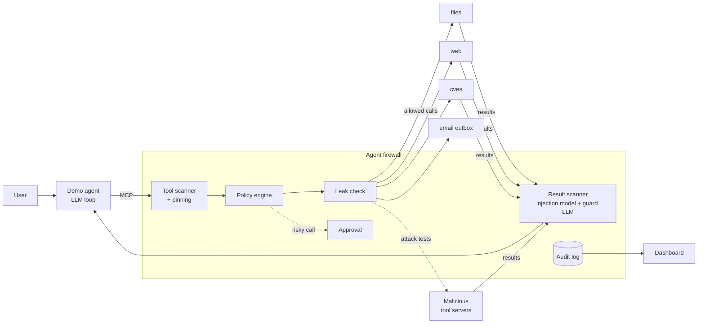
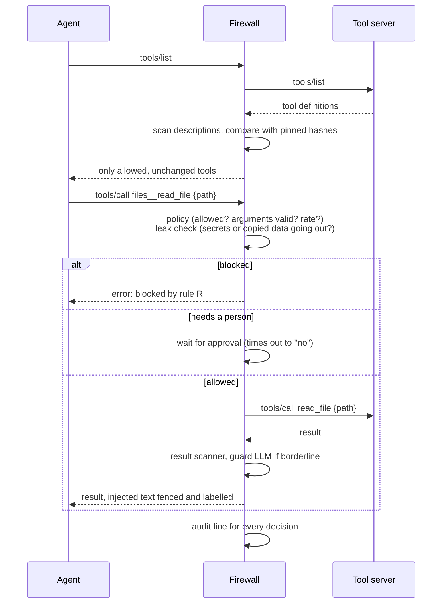

# Architecture (v1)

Written before any code. It will change as the build teaches me things, and each change gets a line under "Decisions".

## Context

An AI agent with real tools, plus the security layer that stops it being turned against its user.

**The agent:** a security assistant that answers questions like "what happened on this server last night?". It reads log files, searches the web, looks up CVEs and can draft an email report. It uses MCP (Model Context Protocol) tool servers, the way agents connect to tools now.

**The firewall:** it sits between the agent and every tool server. It checks tool descriptions before the agent sees them, and every tool call before it runs. It also checks what each tool returns before it goes back to the model, and it logs every decision.

**The questions it answers, with numbers:**
1. **How often do known agent attacks get through, with the firewall on and off?** The attacks are poisoned tool descriptions, instructions hidden in web pages and logs, data leaking out through tool arguments, and a tool changing after it was approved.
2. **How often does it get in the way of normal work?** That's false blocks on ordinary agent tasks.
3. **What does it cost in latency?**

**Why this project:**
- Agents with MCP tools are what AI engineer roles ask for now.
- Securing them is new: OWASP's Top 10 for LLM applications and its agentic AI threat list both name these attacks.
- It builds on my [prompt-injection-guard](https://github.com/AnoushahWasif/prompt-injection-guard) project, whose model becomes one of the firewall's checks.

**Two LLMs of our own:**
- **A guard model:** a small open LLM, fine-tuned with LoRA to judge tool calls and tool results, used as one of the firewall's checks.
- **A tiny GPT trained from scratch:** a learning notebook that shows how an LLM works inside, from the tokenizer to attention and training.

## Components

| Component | What it does |
|---|---|
| **Demo agent** | A small agent loop: the LLM picks a tool, the call goes out through the firewall, the result comes back. One adapter for a local open model through Ollama (free, on this laptop); tests use a scripted fake model |
| **Tool servers (MCP)** | Our own small servers: `files` (read-only, one folder), `web` (fetch a page), `cves` (OSV lookup), `email` (writes to an outbox folder, never really sends). Plus deliberately malicious servers for the attack tests |
| **Firewall proxy** | Speaks MCP on both sides, so any MCP agent can use it, not just ours |
| ↳ Tool scanner | On `tools/list`: flags hidden instructions in descriptions (imperatives to the model, invisible Unicode, mentions of other tools or of secrets) and pins each tool's definition by hash. A changed definition is blocked until it's approved again |
| ↳ Policy engine | A YAML policy, deny by default. It sets which servers and tools are allowed, checks arguments against schemas, and keeps allow-lists for paths and URL domains, plus rate limits per tool |
| ↳ Leak check | Outgoing arguments are checked for secrets (keys, tokens, private keys), for personal data, and for content copied from earlier tool results that's heading to a tool that sends data out (web, email) |
| ↳ Result scanner | Tool results are scored by the prompt-injection-guard model. Suspicious text is fenced and labelled as untrusted data, or the result is withheld (policy decides) |
| ↳ Guard LLM | Our fine-tuned small model (see below). It judges what the rules can't settle, such as "is this tool result trying to give the agent orders?". Only borderline cases go to it, so it doesn't slow every call |
| ↳ Approval | Calls the policy marks as risky wait for a person to say yes or no |
| ↳ Audit log | One JSON line per decision: what was asked, the rule that decided, and the outcome. It holds hashes and rule ids rather than secrets |
| **Dashboard** | Next.js static site: recent decisions, blocked attacks, waiting approvals |
| **Evaluation harness** | Replays the attack set and the normal-task set with the firewall on and off, and writes the numbers to `reports/` |

## Data flow



A call goes: agent → scanner (is this tool known and unchanged?) → policy (allowed, with these arguments?) → leak check (is anything sensitive leaving?) → tool → result scanner → agent. Each step can allow, block or ask a person, and each decision is logged.

### How the proxy works

- **The agent's side:** the agent is configured with one MCP server, the firewall. The agent never learns the real servers' addresses or commands.
- **The tools' side:** the firewall starts each configured tool server itself (stdio), or connects to it (Streamable HTTP, day 16). It lists their tools under names that include the server, such as `files__read_file`, so two servers can't pass off one tool as the other.
- **What's checked:** the firewall handles `tools/list` and `tools/call` and checks both. It doesn't pass on `resources` or `prompts` in v1; the agent sees them as unavailable (decision 13).
- **Requests from a tool server to the agent are refused by default:**
  - **What they are:** MCP lets a server ask its client things. It can borrow the agent's model (`sampling`), ask the user a question (`elicitation`), or ask which folders it may use (`roots`).
  - **Why refuse them:** a malicious server can use them to talk to the model or the user directly, around every check on tool calls.

### One call, step by step



### How checks combine

- **What each check returns:** `allow`, `label` (allow, but fence part of the result), `ask` (a person decides) or `block`, with a rule id and a short reason.
- **How they combine:** the strictest answer wins, and the order is block, ask, label, allow.
- **When a check breaks:** a check that crashes or times out answers `block` for calls, and `label` for results. A broken check never lets something through silently.

## Repository layout (planned)

```
src/agent_firewall/
    proxy/        MCP proxy: client side, server side, routing
    checks/       tool scanner, policy, leak check, result scanner, guard LLM
    policy/       YAML loading and schema
    audit.py      hash-chained JSON lines
    agent/        demo agent loop, model adapters (scripted fake, Ollama)
    tools/        our MCP tool servers (files, web, cves, email outbox)
attacks/          attack and normal-task cases, as data, with sources
evaluation/       harness and metrics
models/           guard LLM training notebook and manifest (weights not committed)
notebooks/gpt-from-scratch/
dashboard/        Next.js static site
infra/            optional Terraform
```

## Evaluation

| Set | What's in it | Source |
|---|---|---|
| **Attacks** | About 60 cases in 6 families: poisoned tool description, tool changed after approval ("rug pull"), a tool imitating another server's tool, instructions hidden in a web page, instructions hidden in a log file, and secrets sent out through arguments | Written by us from published write-ups, each with its source noted. Some also come from public agent-attack benchmarks, if their licences allow (checked on day 2) |
| **Normal tasks** | About 60 ordinary jobs: summarise a log, look up a CVE, draft a report email | Written by us |

**Metrics:**
- Attacks stopped, per family, with the firewall on and off.
- Normal tasks wrongly blocked.
- Latency added, p50 and p95.

Agents are random, so each case runs several times, with intervals.

**Honesty rules:**
- The attack set is split. Rules are written against half of it, and the other half is scored once at the end, like a test set.
- Attacks we don't stop are kept and reported. They aren't quietly removed.

## The guard LLM (fine-tuned)

| Item | Choice |
|---|---|
| Base model | A small open instruct model, about 0.5 to 1.5B parameters, under Apache-2.0 or MIT (for example Qwen's small models). The exact model, revision and licence are pinned on its day |
| Task | Input: a tool's description, a tool call, or a tool result, with its context. Output: `safe` / `attack`, the attack type, and a one-line reason, as fixed JSON |
| Training data | The development half of our attack and normal sets, prompt-injection-guard's training data (licences already checked there), and generated variations of our own cases. The held-out attack half is never used for training |
| Method | LoRA adapters with Hugging Face PEFT, trained on a free Colab GPU. Every setting, the data hash and the base model revision are saved with the adapter |
| Running it | Adapters merged and saved as safetensors (never pickle), hash-pinned like prompt-injection-guard's model, running on the laptop CPU |
| Compared against | The rules alone, the prompt-injection-guard TF-IDF model, the base model with no fine-tuning (prompt only), and the fine-tuned model, all on the same held-out half: attacks caught, false alarms, latency |
| Honest outcome | If fine-tuning doesn't beat the cheaper checks, the README says so, and the firewall uses what works best |

## The tiny GPT (from scratch, learning notebook)

- **What gets built:** a decoder-only transformer written in PyTorch, step by step:
  - a tokenizer (byte-pair encoding, trained ourselves);
  - embeddings and self-attention with a causal mask;
  - the training loop.
- **Size and data:**
  - **Model:** about 5 to 10 million parameters, trained on a laptop CPU, or a free Colab GPU if that's too slow.
  - **Corpus:** public security text (CVE descriptions, and MITRE ATT&CK technique descriptions under its terms, with attribution).
- **What it shows:** loss curves, text samples at several points in training, and what attention looks at. It also shows clearly why this tiny model can't do the guard's job, and why fine-tuning a pretrained model is the right tool for that.
- **Where it lives:** its own folder (`notebooks/gpt-from-scratch/`) with its own tests (shapes, causal masking, and a loss that falls on a tiny batch). It's separate from the firewall code.
